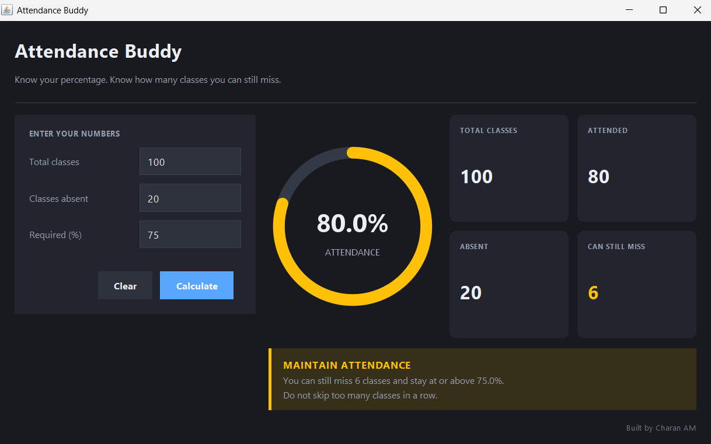
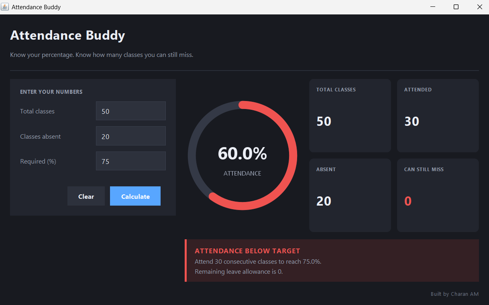
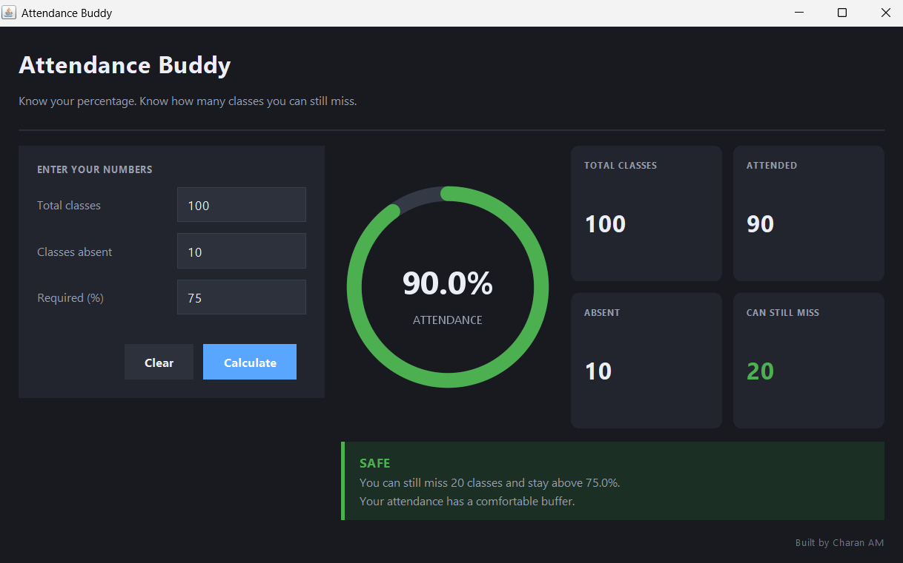

# Attendance Buddy

**A desktop attendance calculator built with Java Swing.**

Attendance Buddy answers two practical questions for a student: *what is my
current attendance percentage?* and *how many classes can I still miss without
falling below the required percentage?*

Enter the total classes conducted, the classes missed, and the required
percentage. The application calculates the result with validated formulas,
animates a circular gauge, updates a four-card dashboard, and explains what to
do next with a colour-coded message.

[Repository](https://github.com/charan-am/AttendanceBuddy) · Java 17+ · Java Swing · No external dependencies



*100 classes conducted, 20 absent, 75% required: 80.0% attendance, 6 classes can still be missed.*

## Problem statement

Students often work out their attendance in their heads or in a spreadsheet.
That leads to avoidable mistakes:

- Calculating a percentage is easy, but deciding how many future classes can be
  missed is not, because every missed class also increases the total number of
  classes.
- Recovering from a shortage requires the opposite calculation: attending extra
  classes raises both the attended count and the total.
- A wrong guess about the leave allowance can push a student below the
  college's minimum attendance requirement.

## Solution

Attendance Buddy performs both calculations accurately and shows the answer as
soon as the numbers are entered. It keeps all formulas in one calculation
class, validates every input, and presents the result in a form that is easy to
read during a busy semester: a gauge for the percentage, cards for the counts,
and a plain-language status message.

The application is deliberately small and dependency-free. It is a single
Java Swing desktop program that runs locally and does not send data anywhere.

## Features

- Calculates overall attendance from total classes, absent classes, and the
  required percentage.
- Shows the **exact percentage** in the centre of an animated circular gauge.
- Displays four dashboard values:
  - total classes conducted,
  - classes attended,
  - classes absent,
  - remaining leave allowance.
- Applies a three-state colour rule relative to the required target:
  - **Red**: below the target, showing how many consecutive classes are needed
    to recover and that the leave allowance is 0.
  - **Yellow**: from the target up to 10 percentage points above it, showing how
    many classes can still be missed.
  - **Green**: more than 10 percentage points above the target, marked **SAFE**
    with the remaining allowance.
- Accepts a custom required percentage; the default is 75%.
- Rejects empty, non-numeric, impossible, or out-of-range inputs with readable
  messages.
- Clears all inputs and results with one button.
- Uses a resizable dark interface and includes a small footer credit.

## Screenshots

### Below target — red

50 classes conducted, 20 absent, 75% required: 60.0% attendance. The app shows
that 30 consecutive classes must be attended and that the leave allowance is 0.



### Safe — green

100 classes conducted, 10 absent, 75% required: 90.0% attendance. The app marks
the status as safe and shows that 20 more classes can still be missed.



## Technology stack

| Area | Technology |
|---|---|
| Language | Java (Core Java) |
| GUI toolkit | Java Swing: `JFrame`, `JPanel`, `JButton`, `JLabel`, `JTextField` |
| Drawing | Java AWT `Graphics2D`, `Arc2D`, `BasicStroke`, `FontMetrics` |
| Animation | `javax.swing.Timer` |
| Architecture | Object-oriented design with five classes |
| Build tooling | `javac` only — no Maven, Gradle, or third-party libraries |
| Testing | A console test harness built into `AttendanceCalculator` |
| Platform | Windows 10/11 instructions below; the Java code itself is portable |

## Application architecture

The project separates calculation from presentation. The calculator has no
Swing imports, so it can be compiled, tested, and reasoned about on its own.

```text
                 user input
                     │
                     ▼
            AttendanceFrame  ──────────────►  AttendanceCalculator
             (Swing UI)                         (formulas + validation)
                     │                                 │
                     │                                 ▼
                     │                          AttendanceResult
                     │                          (immutable data)
                     │                                 │
                     ├───────────────┬─────────────────┘
                     ▼               ▼
            AttendanceGauge     DashboardCard × 4
            (Graphics2D)        (title + value)
```

### Class responsibilities

| Class | Responsibility |
|---|---|
| `AttendanceFrame` | Creates the window and layout, reads input fields, handles button clicks, and updates the gauge, cards, and status panel. Also contains `main()`. |
| `AttendanceCalculator` | Owns all attendance formulas and input validation. Contains a console test harness. No Swing code. |
| `AttendanceResult` | Immutable result object holding total, attended, absent, target, percentage, leave allowance, and classes to recover. |
| `AttendanceGauge` | Custom `JComponent` that draws the circular gauge with `Graphics2D` and animates the value with a Swing `Timer`. |
| `DashboardCard` | Reusable rounded panel that displays a title and one value. |

### Project structure

```text
AttendanceShortageCalculator/
├── src/
│   └── attendance/
│       ├── AttendanceFrame.java
│       ├── AttendanceGauge.java
│       ├── DashboardCard.java
│       ├── AttendanceCalculator.java
│       └── AttendanceResult.java
├── docs/
│   └── screenshots/
│       ├── dashboard-yellow.png
│       ├── dashboard-red.png
│       └── dashboard-green.png
├── out/                  (generated .class files; not committed)
├── .gitignore
└── README.md
```

## How the attendance is calculated

Let:

- `T` = total classes conducted,
- `A` = classes absent,
- `C = T - A` = classes attended,
- `p` = required attendance percentage (for example 75).

### 1. Current attendance

```text
percentage = 100 × C / T
```

Example: 100 conducted and 20 absent gives `C = 80`, so the percentage is
`100 × 80 / 100 = 80.0%`.

### 2. Remaining leave allowance

If the student misses `k` more classes, the attended count stays `C` but the
total becomes `T + k`. The allowance is the largest whole `k` that still keeps
the percentage at or above the target:

```text
100 × C / (T + k) ≥ p
```

Solving for `k`:

```text
k = floor(100 × C / p - T)
```

Only whole classes count, so the result is rounded **down**. If the student is
already below `p`, the allowance is 0.

Example: `T = 100`, `C = 80`, `p = 75` gives
`floor(100 × 80 / 75 - 100) = floor(6.66...) = 6` classes.

### 3. Classes needed to recover

If the student is below the target, attending `x` consecutive classes raises
both the attended count and the total:

```text
100 × (C + x) / (T + x) ≥ p
```

Solving for `x`:

```text
x = ceil((p × T - 100 × C) / (100 - p))
```

A student cannot attend part of a class, so the result is rounded **up**.
If the student is already at or above `p`, this value is 0.

Example: `T = 50`, `A = 20`, so `C = 30` and the current percentage is 60%.
With `p = 75`:
`ceil((75 × 50 - 100 × 30) / 25) = ceil(750 / 25) = 30` classes.

### 4. Floating-point tolerance

The engine uses a small tolerance (`1e-9`) when comparing percentages and when
rounding. This prevents a value that is mathematically exact, such as 75.0%,
from being treated as 74.999999999% because of binary floating-point storage.

### Worked examples

| Total | Absent | Attended | Target | Percentage | Can still miss | Must attend |
|---:|---:|---:|---:|---:|---:|---:|
| 100 | 20 | 80 | 75% | 80.0% | 6 | 0 |
| 50 | 20 | 30 | 75% | 60.0% | 0 | 30 |
| 4 | 1 | 3 | 75% | 75.0% | 0 | 0 |
| 100 | 10 | 90 | 75% | 90.0% | 20 | 0 |
| 100 | 25 | 75 | 80% | 75.0% | 0 | 25 |

### Colour rules

The colour is based on the student's percentage relative to the target:

| Condition | Colour | Status message |
|---|---|---|
| Percentage < target | Red | `ATTENDANCE BELOW TARGET` with the number of consecutive classes needed |
| Target ≤ percentage ≤ target + 10 | Yellow | `MAINTAIN ATTENDANCE` with the remaining allowance |
| Percentage > target + 10 | Green | `SAFE` with the remaining allowance |

For the default target of 75%, this means below 75% is red, 75% through 85% is
yellow, and above 85% is green. The rule is relative: 75% is yellow when the
target is 75%, but red when the target is 80% because it is below that target.

## Prerequisites

- **Windows 10 or Windows 11** for the commands below.
- **JDK 17 or newer** installed. The project was developed and tested on
  **Oracle JDK 26**.
- `java` and `javac` available on the `PATH`.
- No Maven, Gradle, or additional libraries are required.

Check the installation in PowerShell or Command Prompt:

```bat
java -version
javac -version
```

Both commands should print a version number. If `javac` is not recognised,
install a JDK and add its `bin` folder to the `PATH`, then reopen the terminal.

## Setup and run on Windows

1. **Clone the repository**

   ```bat
   git clone https://github.com/charan-am/AttendanceBuddy.git
   cd AttendanceBuddy
   ```

   If the repository was downloaded as a ZIP, extract it and open a terminal in
   the extracted folder instead.

2. **Compile the source files**

   ```bat
   javac -d out src\attendance\*.java
   ```

   This creates the `out` folder containing the compiled `.class` files.
   `out` is generated output and is ignored by Git.

3. **Launch the application**

   ```bat
   java -cp out attendance.AttendanceFrame
   ```

   The Attendance Buddy window opens. This launch method uses the locally
   installed Java runtime; no standalone installer is provided.

4. **Optional: run the calculation tests**

   ```bat
   java -cp out attendance.AttendanceCalculator
   ```

   The final line should be `ALL TESTS PASSED`.

## How to use the application

1. Enter the **total classes** conducted so far.
2. Enter the number of **classes absent**.
3. Enter the **required percentage** (75 is filled in by default).
4. Press **Calculate**.
5. Read the gauge, the four cards, and the status message.
6. Press **Clear** to empty the inputs, reset the required percentage to 75, and
   return the dashboard to its starting state.

The window can be resized. Its minimum size is 940 × 580 pixels.

## Testing

### Included test harness

The repository contains a runnable console test harness in
`AttendanceCalculator.main`. It is plain Java and does not require JUnit or any
other library.

Run it with:

```bat
javac -d out src\attendance\*.java
java -cp out attendance.AttendanceCalculator
```

The harness checks six valid calculations and five invalid inputs. These are the
actual expected and observed results:

| Total | Absent | Target | Expected percentage | Expected allowance | Expected recovery | Result |
|---:|---:|---:|---:|---:|---:|---|
| 100 | 20 | 75% | 80.0% | 6 | 0 | PASS |
| 50 | 20 | 75% | 60.0% | 0 | 30 | PASS |
| 4 | 1 | 75% | 75.0% | 0 | 0 | PASS |
| 100 | 10 | 75% | 90.0% | 20 | 0 | PASS |
| 10 | 8 | 75% | 20.0% | 0 | 22 | PASS |
| 100 | 25 | 80% | 75.0% | 0 | 25 | PASS |

The invalid-input checks confirm that these are rejected:

- total classes equal to zero,
- negative absent classes,
- absent classes greater than total classes,
- required percentage equal to 0,
- required percentage equal to 100.

A successful run prints `ALL TESTS PASSED` and exits with status code 0. A
failure prints the failing case and exits with a non-zero status code.

### Interface verification performed

During development, the following behaviour was checked against the running
application:

- all five example scenarios entered through the GUI, including the exact
  percentage, card values, status colour, and message (75% against an 80%
  target is red, because it is below that target);
- colour boundaries at the target, at target + 10, and one point either side;
- 0% and 100% attendance, including the empty and full gauge;
- empty, non-numeric, negative, excessive, and out-of-range inputs;
- the Clear button resetting the inputs, gauge, cards, and status panel;
- window layout at 1000 × 620, 940 × 580, and 1400 × 800 pixels;
- the gauge animation settling exactly on the calculated value.

A temporary acceptance harness was also used during development and completed
283 checks without failure after the gauge animation had settled. It is not
shipped in this repository; the console test harness described above is the
included, reproducible test suite.

## Current limitations

- The application calculates **overall attendance only**. It does not track
  individual subjects or timetables.
- Classes are counted as whole numbers; partial classes are not supported.
- Results are not saved. Closing the application discards the current values.
- The required percentage must be greater than 0 and less than 100.
- There is no history, export, or comparison between semesters.
- The interface is dark-themed only.
- The project runs from source with `javac`/`java`. It is not distributed as a
  standalone installer or executable package.
- The minimum window size is 940 × 580 pixels.

## Future improvements

- Subject-wise attendance tracking with per-subject targets.
- Optional local saving or CSV export of attendance records.
- A "what if" planner showing the effect of missing or attending future classes.
- Automated UI tests with a framework such as JUnit and AssertJ Swing.
- Packaging with `jpackage` as a native Windows application, which would remove
  the need for users to run Java commands manually.
- Keyboard shortcuts and improved accessibility support.
- A light theme alongside the current dark theme.

## Author

**Charan AM**

- GitHub: [@charan-am](https://github.com/charan-am)
- Repository: [charan-am/AttendanceBuddy](https://github.com/charan-am/AttendanceBuddy)

Built as a Java Swing learning project and for college demonstration.
